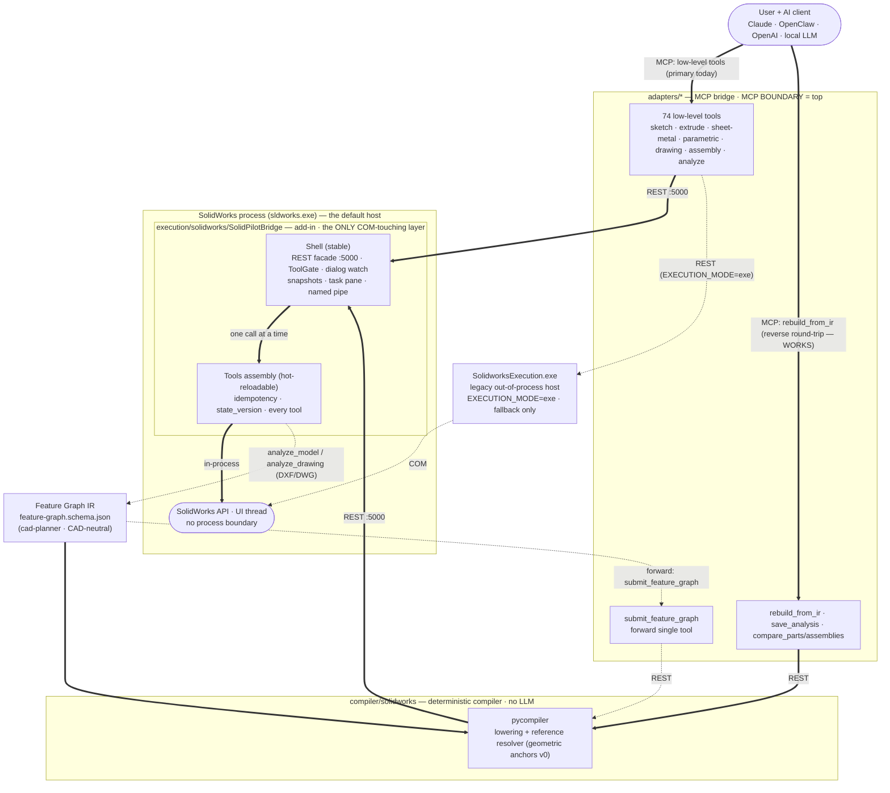

# SolidPilot

**AI-driven CAD automation for SolidWorks — an MCP (Model Context Protocol) server.**

<p align="center">
  
</p>

SolidPilot lets an AI model work with SolidWorks at the **CAD feature level**. The goal is for the model to reason in terms of "which CAD intent am I realizing?" instead of "which API method should I call?". Intent is converted into a CAD-neutral intermediate representation, and a deterministic compiler lowers that representation into concrete SolidWorks operations.

SolidPilot is **not** a Claude-only plugin; it is **a general bridge between SolidWorks and AI.** Because MCP is an open standard, any MCP-capable AI client can connect — alongside Claude, OpenClaw, OpenAI-based agents, and local LLMs are also targeted. The architecture was designed for this extensibility **from the start**: the execution and planner layers do not know which client is calling them; a thin adapter per client reuses a shared bridge core. `adapters/claude/` is the current implementation; supporting a new AI client means only adding a new adapter.

> Repository: `mcp-server-solidworks` · Public name: **SolidPilot** · Target version: **SolidWorks 2026 SP3**

> **Execution is in-process.** The tools no longer run in a separate server: they run **inside SolidWorks**, in the *SolidPilot Bridge* add-in, behind the same REST contract on `localhost:5000` — more stable, typed, and wrapped in a safety gate (dialog refusal, automatic snapshots, STOP, crash forensics). See [In-process execution](#in-process-execution-the-solidpilot-bridge-add-in), and [Installation](#installation-and-running) to register the add-in.

---

## Core Idea

The SolidWorks API exposes thousands of methods. Presenting each one to the AI as a separate "tool" explodes context size and token cost — the economic problem that stalls similar projects.

SolidPilot solves this by **raising the level of abstraction**:

- The AI produces intent at the **feature level** (for example, "put a hole in the top face").
- That intent is expressed as a CAD-neutral **Feature Graph IR**.
- A deterministic **compiler** lowers the IR into ordered, concrete SolidWorks operations.
- A single feature therefore maps to many low-level operations, and one model call per request is enough.

Because the IR is the spine, the same machinery runs **backwards**: a 2D technical drawing is design intent expressed in two dimensions, so it can be read into the same IR and built.

### From a 2D drawing file to a solid part

Hand SolidPilot a **.DXF or .DWG** — the file a supplier or a customer actually sends, with no model behind it — and it reconstructs the part:

```
drawing.dwg → analyze_drawing → (draw dialect: views, edge classes, chained contours,
              true-valued dimensions, bend notes) → Feature Graph IR → compiler → SolidWorks
```

The reader decides which of two answers the drawing warrants. When every decision the part needs is **forced by the drawing itself** — today, sheet-metal flat patterns — it lowers the whole part to IR on its own and `analyze_drawing(mode='build')` builds it in one call. When the drawing needs real engineering reading (the normal case for a machined part), it says so and hands over the structured analysis, which the model interprets under a versioned rule set (the `recipe://usage/reverse` resource) and builds through `submit_feature_graph`.

Either way the result is checked, not assumed: expected volume is computed from the drawing's own dimensions *before* building and read back after. Nine real drawings have been reconstructed this way so far — four in-house samples (two of them sheet metal) and five production manufacturing sheets (A4/A3/A1, 1:1 to 1:10, three different title-block templates), each verified against its own title-block weight to within 0.02% or against the original part to exact topology.

---

## Architecture



Read the diagram by line style: a **thick line works today**, a **dashed line is planned**. Two MCP doors are live — the low-level tools (the primary path today), and **`rebuild_from_ir`**, which drives the **real** deterministic compiler to reproduce a part — or an assembly — from its Feature Graph IR. The dotted reverse arrow is the discovery step: `analyze_model`/`analyze_drawing` read an existing part so an IR can be proposed for it. The only dashed (still-planned) piece is the *forward* collapse — a single `submit_feature_graph` tool that would replace the low-level surface for building from scratch; it runs through the same compiler. The dotted line from the adapter to `SolidworksExecution.exe` is not a plan: it is the **legacy fallback host** (see [In-process execution](#in-process-execution-the-solidpilot-bridge-add-in)).

The system has four layers:

| Layer | Directory | Language | Responsibility |
|---|---|---|---|
| Planner / Intent | `cad-planner/` | AI model + IR schema | Turns user intent into a CAD-neutral Feature Graph IR. Never touches COM, never emits raw tool calls. |
| Compiler | `compiler/solidworks/` | Deterministic (no LLM) | Lowers the IR into ordered tool calls; resolves semantic references (e.g. `top_face`, `center`) against live geometry state. |
| Execution | `execution/solidworks/` | C# (.NET Framework) | The **only** layer that touches the SolidWorks COM API. The single source of truth for CAD state. **Runs inside SolidWorks**, as the SolidPilot Bridge add-in (default); the same tool source also builds as a standalone `.exe` (fallback). |
| Adapter | `adapters/claude/` | Python (MCP SDK v2) | MCP protocol bridge. The MCP boundary sits at the **top** of the system. |

**MCP sits at the top:** it is the boundary where the AI client meets the system, not an internal transport. Everything below the IR is deterministic and communicates over plain REST — to a REST façade that now lives **inside the SolidWorks process** (below).

The `adapters/` layer is provider-specific and replaceable. Because the execution and planner layers do not know which client is calling, adding a new AI client (OpenClaw, OpenAI, a local LLM, etc.) means only writing a new adapter — the IR, compiler, and execution layers stay unchanged.

**Current vs. target:** the Feature Graph IR and the deterministic compiler now **exist and work** — the compiler (`compiler/solidworks/pycompiler`, lowering + a v0 reference resolver) has reproduced **real production parts** end-to-end from their IR to a `verified` match (see Project Status). It is reached today through the **`rebuild_from_ir`** tool (the reverse/reproduce direction). What is still ahead is the *forward* collapse: replacing the low-level surface with a single `submit_feature_graph` tool for building from scratch, and a **durable reference resolver** that survives edits (the make-or-break module). Until then the low-level MCP tools remain the primary path for building.

---

## In-process execution: the SolidPilot Bridge add-in

The tools no longer run in a separate process. Since the in-process host became the default (bridge v0.8), **every tool runs inside SolidWorks itself**, in an add-in: [`execution/solidworks/SolidPilotBridge`](execution/solidworks/SolidPilotBridge). Nothing above it changed — the adapter, the compiler and the IR round trip still speak the same four REST endpoints on `http://localhost:5000`; the add-in simply serves them from inside the `sldworks.exe` process. This is the largest architectural change of the project, so here is what it is, why it was made, and what it costs.

### Why

- **Stability.** On SolidWorks 2026 SP4.0 the out-of-process execution layer crashed SolidWorks on two out of two runs of a plain *new part → sketch → four lines* sequence (identical stack, entirely inside SolidWorks' own idle UI code). The same sequence through the in-process host ran 20 times without a crash, and the host has since served thousands of calls through the live suites. The reading: an out-of-process COM call is serviced *inside* SolidWorks' idle processing and cuts into its UI work, whereas an in-process call is posted to the UI thread and waits for that work to drain, so it never interleaves. The wait is the price (the first `create_sketch` of a new document takes 2–5 s instead of 0.4 s); the stability is the gain.
- **Control.** The tools are typed C# against the full API with no marshalling: entities are selected as objects instead of by view-dependent pick, every definition is read back after it is written, and operations that were awkward from outside become routine (see [Sheet-metal control](#sheet-metal-control-through-the-typed-api)). Chatty read traversals are about 200× cheaper (≈3 µs against ≈0.6 ms per API call); work SolidWorks itself performs costs the same on both sides, so speed is a side effect, not the reason.
- **A place for a safety net.** Living inside the session makes a gate possible: refuse calls while a modal dialog is open, snapshot unsaved work before anything destructive, an on-screen STOP, crash forensics (below).
- **Honest costs.** Tool exceptions now run inside the user's SolidWorks session. A change to the add-in *shell* needs a SolidWorks restart (the DLL is locked while loaded) — only the *tools* reload live. The add-in is base-class-library only, because SolidWorks loads it into its own AppDomain, where third-party package versions clash.

### How it is built

| Part | What it is | Changing it |
|---|---|---|
| **Shell** — `SolidPilotBridge.dll` | x64, .NET Framework 4.5.2, BCL-only. The add-in lifecycle; `UiThread` (runs work on SolidWorks' UI thread); `ToolGate` (admission control); the REST façade; a named pipe; the dialog watcher; snapshots; the task pane; an in-process C# script runner. | Needs SolidWorks closed. Small and deliberately stable. |
| **Tools** — `SolidPilotBridge.Tools.dll` | .NET Framework 4.8. `ToolsHost` (JSON request handling, byte-compatible with the standalone exe) plus the **same `Services/*` source files the exe compiles** — linked, not copied — so both hosts run identical tool logic. | Hot reload: loaded from bytes (the file never locks) and swapped with `reload_tools`. `state_version` and the idempotency memory survive the swap. No restart. |

A request takes this path:

```
AI client ─MCP─▶ adapter ─POST /api/tool/execute─▶ REST façade   (localhost only: refuses a browser Origin, a foreign Host, a non-JSON POST)
                                                       │
                                                       ▼
                                                   ToolGate      pre-flight: modal dialog open? paused? UI thread answering?
                                                       │         snapshot the dirty document · note the call as "in flight"
                                                       ▼
                                 SolidWorks UI thread ─▶ ToolsHost ─▶ SolidWorksService ─▶ SolidWorks API
                                                       │
                                 reply: COMPLETED | FAILED | DUPLICATE  (+ state_version, result geometry)
```

One call runs at a time. The REST contract, the JSON shapes, the strict `state_version` check and the `operationId` idempotency ledger (see [CONTRIBUTING.md](CONTRIBUTING.md)) are identical for both hosts; `tests/inproc-parity.ps1` replays one scripted session against both and diffs the replies.

### The safety gate

Because the tools share a process with the user's work, nothing runs blindly. A client sees these refusals:

| Code | Meaning |
|---|---|
| `DIALOG_BLOCKING` | A modal dialog is open in SolidWorks. The call is refused instead of hanging; answer the dialog (by hand, or `dialog_respond` on the pipe) and retry. |
| `SW_BUSY` | The UI thread did not answer within 20 s (`SOLIDPILOT_UI_WAIT_SEC`), or another call held the gate for longer than the call timeout. |
| `STA_TIMEOUT` | One call ran longer than the call timeout (120 s, `SWMCP_STA_TIMEOUT_SEC`). |
| `USER_PAUSED` | The user pressed **STOP** in the task pane; the next call is refused until **Resume**. (STOP cannot interrupt a call SolidWorks is already executing.) |

- **Task pane "P"** in SolidWorks' Task Pane: the gate state (idle · running *tool* · PAUSED · dialog open), STOP / Resume, *Snapshot now*, *Folder*, and a live activity log of every call (tool, result, time). Disable with `SOLIDPILOT_PANE=0`.
- **Automatic snapshots.** Before a call that can change or destroy work, a document with unsaved changes is saved as a silent copy (`SaveAs3` with the *copy* option: the document keeps its name, path and modified state) into `%LOCALAPPDATA%\SolidPilot\snapshots`, at most once per document per 120 s, pruned to the latest eight per document (40 files and 3 days overall). The analysis, export, save, open and document-switch tools skip it. Cost, measured: every copy leaves about 16 Windows handles in SolidWorks that are not released later — negligible for a working session, but switch the policy off (`SOLIDPILOT_SNAPSHOT_SEC=0`, or `snapshot_policy off` on the pipe) for loops that open hundreds of documents.
- **Crash forensics.** The request being executed is written to `%LOCALAPPDATA%\SolidPilot\inflight.txt` before the call and removed after it. If SolidWorks dies mid-call, the next start reports exactly which call it was (in `/health` and in `bridge.log`).
- **Localhost only.** The façade binds to `localhost`. A browser must never be able to drive CAD, so a request carrying an `Origin` header (CSRF), a foreign `Host` header (DNS rebinding) or a non-JSON content type on POST is refused.

### Driving SolidWorks' own user interface from inside

Some SolidWorks features cannot be created through the API at all — *Convert to Sheet Metal* is the one that matters here: `CreateFeature` returns `null`, `InsertConvertToSheetMetal2` half-builds on a surface body, and the PropertyManager's bend and rip lists can be filled only by genuine picks. Out of process that meant keyboard and mouse automation. In process there is a better route, because SolidWorks 2026 builds that PropertyManager as a **WPF control in its own process**: from the add-in its visual tree is a plain object graph, and its buttons, check boxes, numeric boxes and lists can be read and driven through the very automation peers UI Automation would use — without a UI Automation client (which, from outside, cost ~55 s to locate the lists and deadlocks when called from the UI thread).

`sheet_metal_convert` therefore does what a person does, in **one gate call**: preselect the fixed face, start the command, fill the lists with picks **in the exact order given** (selection order is part of the recipe), write the settings into the PropertyManager's own boxes, press OK — and read the created feature back. How it stays safe:

- **Everything is resolved before the first UI action** (face, edges, rip sketches, settings, a geometric pre-check that the bends fit: a bend takes up (radius + thickness) × tan(deflection / 2) on each side of its virtual sharp, so two parallel right-angle bends need 2 × (radius + thickness) between them while the two shallow bends of a jog need much less; a flange must be longer than one take-up). A request that cannot work is refused with the numbers and **nothing is opened**.
- **A pick is a posted mouse message** at a pixel computed from the view transform **and the real position of the graphics window** (the transform's translation is measured from that window's top-left corner, found through Win32; it was once taken as an absolute screen x, which held only while the window started at x = 0 - a toolbar docked on the left, 45 px wide, moved it and every pick missed by 45 px; `convert-tests.ps1 C18` moves the window 300 px and converts), chosen where the edge is farthest from every other edge on screen, and **verified twice**: the list must grow by one *and* the selection manager's newest entry must be the intended edge or sketch — a wrong pick cancels the whole command. When no candidate pixel has 4 px of clearance at fit zoom (two creases of a 2 mm jog on a 500 mm part sit only 3 px apart), the picker **zooms onto the target** and scores again (`ZoomToModelPoint`: `ModelDoc2.ViewZoomTo2` takes view coordinates, y up), and `views` accepts custom named views. The user's cursor and focus are not touched.
- **Clicks only ever go to SolidWorks' own windows.** If a window of another application covers the graphics area, the call stops with `GRAPHICS_COVERED` (and `ui_inspect post_click` with `FOREIGN_WINDOW`); nothing is clicked. Run it with SolidWorks **in front** (a maximised window is still the most reliable; the earlier "a restored window lands on faces" observation was the same window-origin error). `tests/convert-tests.ps1 -Cover` proves it by putting a top-most window over the view and checking that it receives no click.
- **No dependence on what SolidWorks remembers.** The PropertyManager remembers its last values; the tool requires `thickness` and `bend_radius` and writes *every* other setting explicitly (the factory default when the request says nothing), so one call never inherits another's state. A **second body** converted into a part that already has sheet-metal parameters is built with the *part's* thickness and radius while the PropertyManager keeps "use the part's parameters" on (a 1.0 / 1.4 mm cover after a 1.2 / 1.2 mm tray came out 1.2 mm): the tool therefore compares the created feature with the request and, where they differ, writes the body's own thickness, radius and thickness side through the feature definition (`OverrideDefaultSheetMetalParameters`), then re-reads it.
- **Dialogs and hangs.** A watchdog thread answers information boxes raised *inside* a click (the nested modal loop would otherwise stop the tool); a dialog that needs a decision is a failure. If the gate gives up on a call (`STA_TIMEOUT`), the tool notices at its next wait, cancels the PropertyManager and stops. The PropertyManager is **always** closed again (OK on success, Cancel on any failure) and the bodies hidden for the picks are shown again - by **fingerprint** (face / edge count and box) with a hide-then-show toggle, because the COM wrappers go stale when the Convert rebuilds the part and `Body2.Visible` reads true for a body that is still not drawn (measured in the rack-chassis retry: ears, tray and a surface stayed invisible after a Convert and the next Convert found nothing to pick). Each converted body also gets **its own K-factor** (the new body's Sheet-Metal feature, not only the first one's). Cuts made through the API **scope themselves to the body of the previous feature**, so a multi-body part is built one complete body group at a time.
- **When SolidWorks itself refuses a pick (measured 2026-11-12, round 7).** The Convert panel raises a modal box for some picks and the call then DEADLOCKS behind it (clicks, Enter and WM_CLOSE do nothing; only killing `sldworks.exe` and relaunching frees it): "This edge is a Rip edge and cannot be selected as a Bend edge" (the second ledge bend of a ledge ring around an opening: the ring is a loop and the panel breaks it at an edge of its own choosing; sketch rips are not counted), "The sketch has more than one open contour" (a rip sketch with two separate lines; the tool now refuses such a sketch up front: `RIP_SKETCH_NOT_ONE_CONTOUR`, one sketch per rip line) and "No pre-made bends were found" (the panel's *Collect All Bends* button collects only filleted bends, so it is not used). For edges that crowd each other in every standard view the `views` list also takes **`rot:dx,dy`** (the isometric view turned about the screen centre by dx / dy radians, e.g. `rot:3.1416,0` = seen from the opposite side). A ledge ring with different ledge widths is therefore built as a base flange plus ONE mitre flange (see the V1 case in `data/round_07/failures.md`, G49).

`ui_inspect` is the exploration face of the same layer (list the WPF windows, dump a visual tree, drive one control, project model points to screen pixels). It exists only in process.

### The development loop, the pipe and the script runner

```
powershell -File execution\solidworks\SolidPilotBridge\deploy-bridge.ps1 -ToolsOnly          # rebuild the tools only (SolidWorks may be running)
powershell -File execution\solidworks\SolidPilotBridge\bridge-ping.ps1 -Command reload_tools  # swap them in: generation +1, nothing else changes
```

Besides REST, the add-in serves a per-user named pipe, `\\.\pipe\SolidPilotBridge` (one command per line, one reply line): `ping`, `state`, `activeDoc`, `dialogs`, `dialog_respond <button>`, `selection`, `events`, `log`, `windows`, `post_click`, `tools_info`, `reload_tools`, `tool <json>`, `pause`, `resume`, `activity`, `gate_timeout`, `snapshots`, `snapshot_now`, `snapshot_policy <seconds|off>`, and **`run_cs <file.cs>`** — compile a C# snippet *inside* SolidWorks and run it against the live API, with no build and no restart. The [`probes/`](execution/solidworks/SolidPilotBridge/probes) folder holds about sixty such probes: the research behind every API fact. Three of them are build helpers rather than research: `probe103_bends.cs` measures every bend of every solid body (partial cylinder faces: axis, radius, angle, length; mitre-flange bends are read from the face's UV bounds), `probe104_custprops.cs` writes document custom properties (`Name=value|Name2=value2`; BrakeNote, Weld, Material_spec, part marks: no typed tool writes them yet) and reads them back, and `probe105_snapshot.cs` renders the model view itself to a BMP (zoom to fit), so a picture cannot be cropped by the task pane that covers part of the window. Two more are build helpers for round 10: `probe106_extend_surface.cs` is Extend Surface of selected edges of a surface body (`IModelDoc2.InsertExtendSurface`: distance, up to a plane or face, linear or same-surface; the extended body takes the feature's name and `D1@Surface-Extend<N>` can be linked; measured 2026-11-18: with NOTHING selected the call crashes SolidWorks, so the edges are always selected first and sliver edges under 1 mm of an offset copy are skipped) and `probe107_flat_sketch.cs` draws rectangles in the flat pattern's own frame (u = the longest edge of the largest planar face, v = normal x u; or one rectangle on every straight edge of a given length, projecting outward) as a named METADATA sketch for process-only features (gauge nubs, grab plates, setbacks); measured 2026-11-18 on the stool leg flat (16 lines, the flat still rebuilds), but a flat whose fixed face gives no body (the stairs stringers) is refused and folded again: a flat DXF exported with `dxf_flags=13` (outline 1 + bend lines 4 + sketches 8) carries it. `tests/tool-call.ps1` calls any tool from PowerShell (`tool-call.ps1 feature_data '{"action":"list"}'`).

### Configuration

Adapter (`adapters/claude/.env` or the environment):

| Variable | Default | Meaning |
|---|---|---|
| `EXECUTION_MODE` | `inproc` | `inproc`: the tools run in the SolidWorks add-in. `exe`: the legacy standalone host, spawned on demand. |
| `EXECUTION_BASE_URL` | `http://localhost:5000` | Where the REST façade listens. |
| `EXECUTION_LAUNCH_SOLIDWORKS` | `1` | Let `ensure_ready` start SolidWorks when it is closed (`0` forbids it). |
| `SOLIDWORKS_EXE` | discovered | Override the SolidWorks executable (default: the COM registration of `SldWorks.Application`). |
| `SOLIDWORKS_START_TIMEOUT` / `ADDIN_WAIT_TIMEOUT` | 300 s / 30 s | How long to wait for the add-in's server after a cold start / when SolidWorks was already running. |

Add-in (environment variables, set before SolidWorks starts): `SOLIDPILOT_PORT` (or the DWORD `HKCU\Software\SolidPilot\Bridge\HttpPort`; default 5000), `SOLIDPILOT_HTTP=0` (no façade), `SOLIDPILOT_PANE=0` (no task pane), `SOLIDPILOT_UI_WAIT_SEC` (20), `SWMCP_STA_TIMEOUT_SEC` (120), `SOLIDPILOT_SNAPSHOT_SEC` (120; `0` = off), `SOLIDPILOT_TOOLS` (folder to load the tools from).

### The legacy host

`SolidworksExecution.exe` — the original out-of-process execution layer — is still built from the same source and still works as a **fallback** (`EXECUTION_MODE=exe`; `SOLIDWORKS_EXEC_PORT` runs it beside the add-in on another port, which is how the parity test compares them). It is not the recommended host: see *Stability* above.

### Live test suites

The add-in made it practical to test CAD behaviour automatically. All of these need SolidWorks running with the bridge, and nothing else open; each is a PowerShell script under [`execution/solidworks/SolidPilotBridge/tests`](execution/solidworks/SolidPilotBridge/tests) that prints PASS / FAIL per case:

| Suite | What it checks |
|---|---|
| `bridge-tests.ps1` | The pipe protocol, dialog handling, the script runner, and the gate against a real modal dialog (`DIALOG_BLOCKING`, recovery). |
| `inproc-stress.ps1` | REST security (Origin / Host / content type), parallel calls, pause / resume, call timeouts, crash forensics, events, tools hot reload (needs a Debug tools build for its fault-injection hooks). |
| `typed-control-tests.ps1` · `forming-tests.ps1` · `parametric-tests.ps1` | The sheet-metal tools against geometry and numbers, not against `COMPLETED`: flat blanks, K-factor, corners, hems, mitre flanges, units, equations, the NEMA cabinet and a lid as a second body. |
| `technique-tests.ps1` | The 2026-11-05 tool improvements against numbers: an open-profile base flange with `depth` (extent and bend count), a cut scoped to one of two bodies (exactly one slot of volume removed), Convert Entities on an arc, a sheet-metal body repeated by a body pattern (3 bodies, 3 flat patterns, count driven by an equation, a circular copy, the mirror refusal), a two-direction cut grid (3 x 2 holes in one pattern). |
| `convert-tests.ps1` | Convert to Sheet Metal driven from inside SolidWorks: every setting reaches the feature, sizes and flat blanks equal their closed forms, the **order of the picks** is the request's order, refusals happen before anything opens, a dialog inside a click is answered, an abandoned call cancels the PropertyManager, defaults never leak between calls, and (`-Cover`) a foreign window over the view is never clicked. |
| `flat-edit-tests.ps1` | Editing a part in its flat state: unfold / fold (closed-form blanks, partial unfolds, repeated calls refused), the multi-radius fillet (volume removed = Σ (1 − π/4) r² h), surface extrude + surface cut (exact volumes, a wrong flip taken out again), a surface cut mirrored. |
| `v4-tests.ps1` | The user's v4 enclosure rebuilt with tools in the user's own recipe, against numbers measured on the reference (and, with `-Reference <v4.SLDPRT>`, its flat DXF compared entity by entity); and the *intended* 16 ga set through the same pipeline with the corner trim mapped onto its corner chord and the seam gaps measured (V04). |
| `fromflat-tests.ps1` | **Fold from flat**: the plan read from a DXF (lines, arcs, holes, hidden / continuous bend lines, units, chords between outline corners), every unfoldable flat refused with the reason before anything is created, and the built parts against their closed forms - a tray, an L bracket, a C channel, a hat - including the part's own flat pattern (exact area, bounding box, and its DXF export equal to the input), and a failed build taken back to the empty part. The flats are written by the tests. |
| `fromflat-recipe-tests.ps1` | **The flange recipe** for closed-corner flats: mitre-flange boxes made by tools (wall + rim + lip, a plain wall, a wall with an outward rim) are written out as flat DXFs by SolidWorks and rebuilt from them - plate, profile points, directions and rip gap read back, the folded extents, bends, outer cutting length and the exported flat DXF line for line equal to the original; `auto` picks the sketched bends for a relieved tray and falls back to the recipe when SolidWorks refuses them (a wide rip gap); flats of another family refused before anything is created; with `-PathB <dxf>` the user's own Path B cabinet flat. |
| `features-tests.ps1` | **The features whose API calls first "built nothing"**: Gusset (flat and rounded, volume = ½ · depth · width · thickness, the profile scheme), Jog (up, down, 45°, the lines at the closed-form distance, the folded length, the blank unchanged), Lofted Bend (half cone: bends, volume of the shell, the facet argument named is the one used, thickness side, formed, a U), Tab and Slot (volumes gained and lost, the positions of the tabs from either end, fillet / chamfer, the tab face found by itself), Move Face (offset, reverse, four faces in one, translate / rotate, an equation driving the distance, a sheet-metal tray) Swept Flange (L, U, Z, line; reverse; offsets; a corner and an arc path; closed forms), **gauge tables** in the base flange (16 Gauge steel: thickness, radius, K-factor and the cut list's `16GA.` from the table row) and **forming tools** (all 16 tools that fit the plate place with their own depth; position, rotation and side measured; the edge face, a bend, an overhang, an unknown configuration and an overlapping tool refused with the part exactly as it was; a louver array with `create_pattern`) and **corner relief** (circular, square, tear, obround and rectangular reliefs on the four corners of a tray: the volume removed and the faces added against the measured numbers, every corner read back, the options, and the refusals - a three-bend relief, a missing length, a circle SolidWorks would not build, a plate without corners - with the part untouched) and **two-body parts** (what the motion-control enclosure of the integration stress test taught: the edge flange's length measured to the outer virtual sharp by default, a K-factor per sheet-metal body, one flat DXF per body), every request that cannot work refused before anything is built. |
| `doc-soak.ps1` | Does a long agent session leak SolidWorks resources? (Handles, memory, GDI and USER objects per build cycle.) |
| `e2e_adapter.py` | The real Python adapter and compiler against the façade: IR build → analyze → save → rebuild → `compare_parts`. |
| `ir-integration-tests.py` | **The IR door against live SolidWorks** (schema 0.8): every sheet-metal DFM node submitted as a Feature Graph through the real compiler and adapter port - the MCP function with a JSON string, a louver array seeded on a typed tool's feature, a refused overhang with the part untouched, gauge table, hem, break corner, gusset, jog, mitre flange (wall and rim + lip), closed corners, corner relief, lofted bend, swept flange, tab and slot, move face, unfold → a radius per fillet edge → fold, unfold → surface cut → fold, settings and flat-pattern options, delete face → offset surface (inward and outward), Convert to Sheet Metal (SKIPPED with the evidence when the screen, not the graph, is the problem), fold from a flat DXF, the planner's reject-and-resubmit loop - with the numbers of the tool-level suites. Needs a Python with the adapter's requirements. |
| `inproc-parity.ps1` · `shell-harness.ps1` · `exec-layer-tests.ps1` | Parity between the two hosts; hosting the shell stack out-of-process to test it before a SolidWorks restart; the safety executor's unit tests (offline). |

---

## Sheet-metal control through the typed API

Running in-process turns sheet metal from "drive the wizard and hope" into something that can be specified, read back and tested. Every sheet-metal tool follows the same four rules:

- **Objects, not picks.** Edges and faces are selected as objects, by the stable index `analyze_model` prints or by geometry — never by a screen point, because a point pick goes *through the current view* (measured: the wrong edge, or a miss, depending on the view).
- **Write, then read back.** `ModifyDefinition` returns `True` even when SolidWorks ignored the value, so every write is verified against a fresh read and reported as `applied` / `ignored` / `unknown` / `rejected`.
- **The numbers come from SolidWorks, not from a prediction.** The flat blank size, the cutting length and the bend count are read live from the cut-list item without unsuppressing the flat pattern, and the flat DXF is written in the document's own unit.
- **Parametric from the first call.** `document_units`, `equations` and `sketch_center_rectangle` make a part variable-driven from tools alone; every dimension that matters can be tied to a named variable.

Covered today: base, edge and **mitre flanges** (one wall, or a multi-segment wall + rim + return-lip profile that is itself fully dimensioned), hems (open, closed, tear-drop, rolled), break corners, closed corners, global and per-bend K-factor, auto relief, flat-pattern options, a direct flat DXF, and typed read/write of *any* feature's definition (`feature_data`) — and, for parts that are **converted** instead of built from flanges: *Delete Face* and *Offset Surface* to prepare the base shape, **Convert to Sheet Metal** driven from inside SolidWorks (see [above](#driving-solidworks-own-user-interface-from-inside)), **Unfold / Fold**, a **multiple-radius fillet** as one feature, **surface extrude / surface cut** and mirror (the corner-trim toolkit).

**Worked proof — a NEMA cabinet body from tools alone.** A 12 × 18 in plate and **one** mitre flange along its four edges (wall + rim + return lip), eight variables (`BoxWidth`, `BoxHeight`, `SheetThickness`, `InsideRadius`, `KFactor`, `WallHeight`, `LipLength`, `ReturnLip`) driving it. Against the same part modelled by hand in SolidWorks:

| | built by tools | modelled by hand |
|---|---|---|
| flat blank (in) | 27.931 × 21.931 | 27.931 × 21.931 |
| outer cutting length (in) | 95.821 | 95.821 |
| bends | 12 | 12 |
| folded size (in) | 12 × 18 × 4.56 | 12 × 18 × 4.56 |

It re-sizes through its variables (wall 5 in → 5.56 in deep and a blank 2 in larger; 14 gauge and back restores the exact numbers), the flat DXF is written in inches, and a lid added as a second sheet-metal body in the same part leaves the cabinet unchanged (`tests/parametric-tests.ps1`).

**Worked proof 2 — the user's v4 enclosure, rebuilt with the user's own recipe.** A rim-and-lip cabinet whose rim is **1.00 in on the 12 in sides and 0.75 in top and bottom** (differential flanges), which a mitre flange cannot make — one profile is swept round the whole loop — so it is *converted*: a 12 × 18 × 4 in box with a 0.5 in lip block, its open face deleted, the surface offset inward by one thickness, four diagonal rip sketches, **Convert to Sheet Metal** with the 12 bend edges picked **in the order the user stored in the reference**, then Unfold → **one** multi-radius fillet on the twelve outline corners (10 / 15 / 5 mm) → a spline corner trim (surface extrude + surface cut + mirrors) → Fold → flat pattern and DXF. Measured read-only on the user's v4 file and compared with the tool-built part (`tests/v4-tests.ps1`):

| | rebuilt by tools | the user's v4 |
|---|---|---|
| feature sequence | box, lip, delete face, offset, 4 rips, Convert, Unfold, Fillet, trim sketch, Surface-Extrude, Surface Cut, Mirror, Fold, Flat-Pattern | identical |
| flat blank (mm) | 571.214 × 710.914 (closed form: 2 × (W/2 + D + rim + lip − 4t − 6r + 3·BA)) | 571.214 × 710.914 |
| bends · folded size (mm) | 12 · 304.8 × 457.2 × 114.3 | 12 · 304.8 × 457.2 × 114.3 |
| outline corners rounded | 12, at the reference positions to 4 µm | 12 |
| outer cutting length (mm) · mass | 2497.89 · 533.71 | 2497.89 · 533.71 |
| flat DXF | 90 entities; every line and arc identical; the 12 splines at the same places | 90 entities |

Two honest notes. The user's file uses t = 1.6 mm, r = 3 mm, K = 0.5 and a 4 in box, while the cabinet they describe as *intended* is 16 ga (1.524 mm), r = 3 t, K = 0.45 and 3.25 in + 0.5 in lip. The whole pipeline runs for the intended set too (`v4-tests.ps1` V04), but the **corner trim is a hand-tuned spline** that belongs to one set of corner geometry: for a new set it is the user's curve *normalised on the corner chord* (the exact unrolled mitre, one bend allowance wide and 0.75 (r + t) deep) and mapped onto the new chord, and it is accepted by a measured criterion - after the fold every distance between the faces at the seam stays at least 0.027 mm (the design gap is 0.03 mm; the untrimmed corner pinches to 0.009 mm and grows a 0.013 mm² sliver face; half the depth still pinches to 0.020 mm). Whether that criterion is the user's meaning of weld-tight is a question for them. And the reference reaches all four trimmed corners with a single mirror feature whose cause is not understood; two mirrors (Right, then Top) give the same four trims.

### Fold from flat

`sheet_metal_from_flat` is the inverse of the flat-pattern export: give it an ASCII DXF and an empty part, and it builds the folded part. It reads the **outline** (lines, arcs, splines, polylines; circles are holes) and the straight **bend lines** (HIDDEN lines, and continuous lines that hang off the outline or join two outline corners), cuts the outline into **regions** along the bend lines, finds the region that stays put (the biggest, or the one under `fixed_point`) and the **tree of bends** that leads to every other region, and builds on the Front Plane: a base flange from the outline, then **sketched bends - the outermost first**, so that every bend line is still in the flat plane when its turn comes, one feature per (depth, direction). The DXF does not say the thickness, the radius or the K-factor, so the caller does; the flat blank does not depend on K (sketched bends keep the flat length), the folded size does.

Two things were learned on the way, and both are enforced:

- **SolidWorks folds a sketched bend along the whole (infinite) line**, however short the sketched segment is (a 20 mm line bends a 60 mm blank across its full 60 mm). So a flat only folds this way when no region reaches across the line of a bend that is not its own. The plan measures that **before it creates anything** and refuses with `BEND_NOT_FOLDABLE` and the reach in millimetres. The flats of Convert to Sheet Metal and of closed-corner flanges - including the NEMA cabinets of this project - are exactly such flats: their wall edges lie 0.3 to 2 mm past the neighbouring bend line, and SolidWorks fails the second wall (measured: the first pair of walls folds, the second returns nothing). They need corner reliefs wider than the bend zone, or a part built with flanges or Convert.
- **Direction.** SolidWorks' own API export draws the two bend directions in two linetypes (HIDDEN and continuous); a DXF saved from the user interface draws every bend the same way and says nothing. `hidden_direction` says what HIDDEN means, and `directions` (one `up` / `down` per depth, innermost first) says it outright - for a cabinet with a lip that turns back, `["up","up","down"]`.

A build that SolidWorks refuses half way (a bend that returns nothing, a feature left with a rebuild error) is **taken back**: the part is empty again and the error says so (`keep_on_failure` keeps the half-built part for a look). The closed-loop proof is built in: the part's **own flat pattern** must have the size of the DXF outline, and the part the bends of the DXF; the tests go further (exact volume = area × thickness with arcs and a hole, and the flat DXF of the built part equals the input DXF).

**Closed corners, one family: the flange recipe.** The first bullet above is why the flat of a *mitre-flange* cabinet cannot be folded with sketched bends — yet that family is regular enough to be **rebuilt from flanges**. A box made by one mitre flange (a base flange, then one mitre flange along the plate's four edges with a wall / rim / lip profile) has bend lines that are **nested rectangles**: a ring of four lines per bend, symmetric about the centre, with the same strip width on all four sides. Everything else follows from the rings and the sheet (`thickness`, `bend_radius`, `k_factor`): the plate is `W = 2 (a₁ − BA/2 + r + t)` (a₁ = the innermost ring's half span, outer sharp); each profile segment is its flat strip plus the setbacks of the bends at its ends (`r + t` where a bend folds up, `r` where it folds down; the first segment less `t`, because the profile starts on the plate's top face); and the rip gap is read from where the wall edges stand, `g = √2 (X − t − x_edge)`. `strategy = "miter_flange"` builds `sketch_center_rectangle` → base flange → mitre flange from that; `"auto"` keeps the sketched bends when the flat folds that way, takes the recipe when it does not, and falls back to it when SolidWorks refuses a sketched bend; the default (`"sketched_bends"`) never builds the recipe, but its refusal now says when the flat is a mitre-flange box. Measured on the Path B cabinet's own flat DXF: plate 12 × 18 in, profile `[[0, 4], [0.75, 4], [0.75, 4.5]]` in and rip gap 0.010 in come back exactly, and the part rebuilt from them has the DXF's flat blank, 12 bends and outer cutting length. The proof is always the part's own flat pattern; what the recipe does not cover is refused before anything is created (`RECIPE_NOT_APPLICABLE`): strips that differ from side to side — *differential flange sizes* need the Convert pipeline above — bend lines that are not parallel to an axis, a first bend that folds down; holes are reported as problems. Tests: [`fromflat-recipe-tests.ps1`](execution/solidworks/SolidPilotBridge/tests/fromflat-recipe-tests.ps1).

**What the API itself cannot do** — measured, and identical in and out of process: create a *Convert to Sheet Metal* feature, write a Convert feature's bend list, or set a gauge table on an *existing* Sheet-Metal feature (`SetUseGaugeTable` answers *NotEnabledOnTemplate*; a base flange takes the table when it is created: see below). Convert is now done through the user interface from inside the add-in (Move Face and the gauge table were on this list until they turned out to be a selection-mark and an order-of-assignments problem: see below).

### Features whose API calls "build nothing" - and what that meant

Most sheet-metal features have an `Insert…` call (or a feature definition) in the API that, tried naively, **returns `null` or builds nothing**. The first reading was "these need the PropertyManager" - and the PropertyManager of this family is a classic Win32 one whose OK button takes no posted click and whose list box crashes SolidWorks when it is sent a key. The second reading, which turned out right for six of the seven features, is that **a `null` is a statement about the inputs**: what decided each one was a detail, found by sweeping the cheap combinations in one probe (stopping at the first success), writing a step log *before* every call that might kill SolidWorks, and reading what the interop types say.

| Tool | Route | What the input turned out to be |
|---|---|---|
| `sheet_metal_gusset` | `CreateDefinition(swFmSMGusset)` | property assignment order (depth, width, scheme); the two faces fetched fresh each call; the gusset stands at the bend's **start vertex** + `offset`. A flat 4 × 10 mm gusset on 1.5 mm sheet adds ½ · 4 · 10 · 1.5 = 29.9 mm³ and 8 faces. |
| `sheet_metal_jog` | two **sketched bends** | `InsertSheetMetalJog` is `void` and builds nothing; the bend lines are `s = (h − (2r + t)(1 − cos a)) / sin a + a (r + K t)` apart, the far one folded first. A 10 mm step in 1.5 mm sheet shortens a 100 mm plate to 91.931 mm, checked to the micron, up, down and at 45°. |
| `sheet_metal_lofted_bend` | `InsertSheetMetalLoftedBend2` | the **profile shape**: one arc (or line, L, U) in each of two sketches builds, a rectangle left open by a tiny segment does not; the facet option names which of chord tolerance / number of bends / segment length / segment angle is used. |
| `sheet_metal_tab_slot` | `CreateDefinition(swFmTabAndSlot)` | the **tab face**: the face of the tab body that *touches* the slot face (the wall's bottom face), not its side face - all 21 properties were accepted either way. Tabs are spread equally between a start and an end offset; the tab body gains count · L · T · H exactly. |
| `sheet_metal_swept_flange` | `CreateDefinition(swFmSweptFlange)` | the **form of the path**: only an array of `DispatchWrapper` around the path sketch's *feature* is recognised (`GetPathType() = 9`); the profile is the `ISketch`. Checked against the closed forms of cross-section and developed length. |
| `sheet_metal_feature base_flange gauge_table=` | `CreateDefinition(swFmBaseFlange)` | the **order** of two assignments: `UseGaugeTable = true` *before* the table is named, and the table's **full path**; the gauge spelled exactly as the table spells it (some names end in a blank). Thickness, radius and K come from the row; 16 Gauge steel: 1.51892 mm, 1.905 mm, 0.5, `16GA.`. |
| `move_face` | `InsertMoveFace3` | the **selection mark**: faces selected with `Mark = 1` (mark 0 returns `null`). Offset, translate (a displacement vector) and rotate; several faces in one feature; the distance is the dimension `D1@Move Face1`, so an equation can drive it - the middle step of the closed-corner chassis chain (Closed Corner → Move Face → Corner-Trim) is no longer keyboard-driven. |
| `sheet_metal_forming_tool` | `InsertFormToolFeature` | the **selection**: the face is selected as an object with a `SelectData` whose X / Y / Z are the pick point - that point is the placement (without it the tool lands elsewhere) and nothing depends on the view. The form stands on the far side of the face, the rotation is counter-clockwise looking at the face from outside, `Flip` changes nothing. All 17 tools of the design library place; a louver adds 158.25 mm³ and 14 faces to the 100 × 60 × 1.5 mm plate, and `create_pattern` repeats it (4 louvers add 4 × 158.25 mm³). |
| `sheet_metal_corner_relief` | `CreateDefinition(swFmCornerRelief)` | the **body scope** and **both slot dimensions**: without `SetBodyScope(body)` SolidWorks collects no corners at all, and `CreateFeature` returns `null` unless `SlotLength` **and** `SlotWidth` are above zero - its own proposal (length 0, width = the sheet) builds nothing, and neither does a circle under 3 mm on 1.5 mm sheet. Five types on two-bend corners, each measured: a 3 mm circle on the 100 × 60 mm tray removes 128.87 mm³ and adds 4 faces (42 → 46). |

**The opposite lesson: forming tools.** The call works for every tool of the library - the trouble is what SolidWorks accepts without a word. A tool whose footprint sticks out past the sheet's edge **extends the sheet** (a louver at the corner grew a 100 × 60 mm plate to 102 × 76.7 mm, error 0); a tool dropped on the **edge face** of the sheet builds a mess with error 0; an unknown configuration silently becomes `Default`; `Flip` is ignored; two tools that overlap report a rebuild error. `sheet_metal_forming_tool` therefore refuses a bend or an edge face up front, and **takes the feature out again** (the volume is restored exactly, the state version does not move) when the result is not the one asked for.

**Corner Relief, and the two crashes it cost.** `sheet_metal_corner_relief` relieves the two-bend corners of a tray (the four corners where edge flanges meet) in one feature. Measured on the 100 × 60 mm tray (20103.843 mm³, 42 faces): a 3 / 4 / 6 mm circle removes 128.87 / 226.68 / 510.01 mm³; a square or rectangular relief follows its length (it is one cut: SolidWorks stores a square relief as a rectangular one); a tear is fixed by the geometry; an obround slot needs about twice its width in length; `center_on_bend_lines` changes the cut and filleted corners are taken by the square and rectangular reliefs only (a circular relief ignores them, and the tool says so). Two crashes taught what is **not** offered: a corner touched after `RemoveCorner` had dropped it is a dangling object, and `CollectAllCorners` answers *error 4* for a three-bend relief type yet still returns an array - setting that type on the two-bend corners killed SolidWorks. So the tool touches the corners only after an answer of 0 and offers only the types measured. **Three-bend corners** (`corner_type="three_bend"`, `Initialize(1)`: three bends meet, e.g. a flange that runs round a bend) take the **rectangular** relief only: on a part that has them `CollectAllCorners` answers 0 with the corners and on a body without them error 6, the relief builds and reads back as type 9 with the length given (a reference part: faces 151 → 159, −23.1 mm³ for 3.175 mm on two corners). The other three-bend types (bend waist, constant width, mixed, full round, suit case) are untested and not offered. A part with several solid bodies needs `body` (the body's name): the feature then holds only that body's corners.

**Still not built:** *Cross-Break*. `InsertCrossBreak` makes a Cross Break feature without a rebuild error, the definition reads back the angle and radius, and the body does not change - for an X corner to corner, four segments to the centre, one diagonal, any selection mark, 3° and 10°, with the sketch made *on* the face. Rip and Insert Bends were not pursued (the closed-corner chassis and the Convert pipeline do not need them), and Corner Relief is built for two-bend corners only. **Nine times SolidWorks died** during this work, always on scratch parts - `AccessSelections` on a *new* Tab-and-Slot definition, vertex reference points, a swept flange defined with sketch features, a second creation on the same edge right after the first, a Corner Relief corner touched after it was removed, a three-bend relief type set on two-bend corners - which is why the probes log to a file.

**A bug found on the way, in the add-in itself:** the automatic snapshot (a silent SaveAs copy before a tool call) **closes the sketch that is being edited**, so the second `add_sketch_entity` after a second `create_sketch` failed with `SKETCH_NOT_ACTIVE` - a new document counts as modified only once its first sketch is left, so its first snapshot fell inside the second sketch. The snapshot now waits while a sketch is open (`Snapshots.cs`; a shell change, live after the next restart of SolidWorks).

---

### Feature Graph IR v0.8: the sheet-metal DFM vocabulary

Everything on this page is reachable as typed tools - and, since the IR schema **0.8.0**, through the **Feature Graph IR** too, which is the planned *only* door for building (`submit_feature_graph`): a planner describes the part as intent, the deterministic compiler (`compiler/solidworks/pycompiler`) runs it. The older IR could say a base flange, sketched bends and edge flanges; 22 node types were added, one per feature, **table driven** (`pycompiler/sheetmetal_nodes.py`: one spec per node - the tool it lowers to, its fields, the units at the tool boundary, its rules - read by one generic validator and one generic lowering):

| IR nodes | Lowers to | What the graph says |
|---|---|---|
| `hem` · `break_corner` · `closed_corner` · `corner_relief` · `miter_flange` | `sheet_metal_hem` · `_break_corner` · `_corners` · `_corner_relief` · `_miter_flange` | edge / face **anchors** `{near:[x,y,z]}`, the feature's own parameters; a closed loop of four edges + `profile_points` is one weld-tight rim and lip; `corner_relief` takes the relief type and its dimensions and relieves every two-bend corner of the part |
| `gusset` · `jog` · `tab_slot` · `move_face` · `forming_tool` | `sheet_metal_gusset` · `_jog` · `_tab_slot` · `move_face` · `sheet_metal_forming_tool` | a forming tool can seed a `linear_pattern` (a louver array); `tab_slot` needs a two-body part (`extrude` `merge:false`) |
| `lofted_bend` · `swept_flange` · `from_flat` | `sheet_metal_lofted_bend` · `_swept_flange` · `_from_flat` | they create the sheet themselves: the first feature (only sketches before them) / the first node; sketches are named by node id and the compiler substitutes the runtime names |
| `convert_to_sheet_metal` · `delete_face` · `offset_surface` · `unfold` · `fold` · `surface_extrude` · `surface_cut` | `sheet_metal_convert` and the surface / fold tools | the enclosure pipeline as a graph; the unfolded blank is edited with `fillet` (a `radius` on each edge anchor = one multiple-radius feature) or a surface cut, then folded back |
| `flat_pattern` · `sheet_metal_settings` | `flat_pattern_control` · `sheet_metal_params` | document state: flat-pattern options, K-factor, bend allowance, relief |

Also new on the older nodes: `sheet_metal` takes a **gauge table** (`gauge_table` + `gauge`), `extrude` takes `merge:false`. **Conventions** are the IR's (lengths metres, angles radians - lowering converts to the tool boundary's degrees). The new nodes are **strict** - an unknown field is an error, not a silent default - and the typed tools' own verdict is **enforced**: a reply that is `COMPLETED` but `verified:false` stops the node with `UNVERIFIED` and the tool's problems, so a graph never builds on a result its tool measured as wrong. `pycompiler/coverage.py` classifies **every one of the 74 execution tools** as reachable from a named IR node or exempt with a stated reason (reads, document management, edits of an existing part, drawings, outputs); a test fails when a tool is added without that decision, and shows each new node really lowers to the tool the manifest names. Known gap: the parametric layer (`document_units`, `equations`, fully defined sketches) is applied with the tools after the build - the graph carries values, not equations.

## Reports, and modeling low LOD before DFM

Two habits make the system useful on real, ambiguous input — a vendor PDF, a photo, a customer's crude model, or a one-line prompt.

**1. Perceive → report → question → only then model.** Before any geometry is created from source media, the media is *measured* (a vector census of a PDF or DXF, a scale audit — a datasheet often draws a generic envelope with true-scale details) and every claim about the part goes into an **evidence ledger**: one line per claim, ranked by confidence, each with an evidence class (A: dimension text or table · B: measured vector geometry · C: visual inference · D: convention or assumption). The ledger becomes a **report** — an HTML page (the source page with numbered, confidence-coloured overlays, the ranked ledger, the questions), a plain-text `*.review.md` that *another agent or a human reviewer* can read and answer, and an `*.answers.json` template. At least one question — chosen by impact × (1 − confidence), and always including the hypothesis the agent does *not* hold — is asked and answered before the first modeling call. After the build, a **closure board** puts the model and the source side by side in the same projections, with the measured checks (flat blank, bend lines, hole positions, volume); anything that disagrees goes back into the ledger. The evidence comes from tools in this repository — `analyze_drawing`, `analyze_model`, `save_analysis`, `compare_parts`, the flat-pattern cut list — and the report generator and process playbooks are agent skills maintained alongside the project.

**1b. The decision rules (Phase 7 post-mortem).** The user's review of the first real stress test turned the work from "can the tools build it" into "does it decide like a fabricator": joints default to tight, closed, weld-ready (a mitre stays a mitre when the picture shows one, never an open gap unless it is drawn); equal flanges are ONE multi-edge feature; **every bend is exactly 90° unless the user states another angle** (an angle read off pixels is never trusted); sizes are nominal and jump to the *next* nominal when a rule (PEM edge distance, hole-to-bend) forces them up; every sketch is fully defined; master shapes come from the surface construction; standard parts get their datasheet outline; the report leads with the build strategy (which IR node and tool builds what) and only then the confidence. The tools that enforce the mechanical half of this are the multi-edge `edge_flange`, the 90° default, `sketch_fully_define` and `sketch_convert_entities` (master-driven profiles); the private skills carry the rest.

**2. Low LOD first, DFM second.** The first model of a part is deliberately crude: a **base shape at BIM LOD ≤ 100** — masses and envelope only, no thickness, no bends, no hardware, on the Front plane, from a fully defined origin-centred sketch — shown as a picture in the report *before* the question round. It exposes misreadings while they are still cheap: which way a return lip points, which face is open, which dimension is the depth. Once it is agreed, the same base shape becomes the **first feature of the sheet-metal part**: it is thickened and given its bends (a surface body offset by one thickness and converted; a mitre flange along the base's edges; or folded from a flat pattern), then taken through the design-for-manufacture steps — equations for thickness, inside radius, K-factor and wall height, corner treatment, the flat pattern, the DXF in the shop's unit, the cut list. "LOD" here means the *source's* level of detail — a crude customer solid is around LOD 100–200, a fabrication drawing is far more — not rendering resolution.

---

## Tool List

The system currently exposes **74 tools** for *doing* (plus `ui_inspect`, an in-process-only diagnostic for SolidWorks' own user interface) and **13 MCP resources** for *reading* — the recipe is served through BOTH `get_recipe(section)` and `recipe://usage/*`, because MCP resources sit in the client's action space and not every host lets a model reach one. A contract test keeps both surfaces honest — the adapter against the execution contract, and every resource URI mentioned in the adapter against what is actually registered (see [CONTRIBUTING.md](CONTRIBUTING.md)). Most tools are low-level CAD operations; a few (`save_analysis`, `rebuild_from_ir`, `submit_feature_graph`, `compare_parts`, `compare_assemblies`) drive the analysis / IR round-trip described below. All lengths are in meters (SolidWorks internal units).

The **resources** carry the rule set and the contracts, not behaviour: `recipe://usage/index` plus one static `recipe://usage/<section>` per rule section, and `schema://feature-graph` + `schema://analysis-artifact`. The split is deliberate — a tool's description is paid on every single turn whether or not it is used, while a resource body costs only when read, so near-static reference material belongs on the resource side.

### Document and lifecycle
- `ensure_ready` — launches SolidWorks via COM and attaches if it is closed (does not open a document).
- `open_new_part` — opens a new part document.
- `open_document` — opens an existing file from disk (native `.sldprt`/`.sldasm`/`.slddrw`; imports `.ipt`/`.CATPart`/STEP/IGES via 3D Interconnect when the translator is available, otherwise returns a clear `OPEN_FAILED`).
- `activate_document` — switches between open documents.
- `save_document` — saves the part or drawing to disk.
- `close_document` — closes the document.

### Sketch
- `create_sketch` — starts a sketch on a plane or a selected face.
- `edit_sketch` — reopens an existing sketch for editing.
- `add_sketch_entity` — adds a sketch entity: line, circle, arc, center arc, ellipse, spline, rectangle, fillet, chamfer.
- `add_sketch_constraint` — adds a sketch relation (horizontal, coincident, etc.).
- `add_dimension` — adds a dimension to the sketch.

### Feature and solid modeling
- `extrude_feature` — boss, cut, revolve, sweep, loft; a boss that touches another body stays a body of its own with `merge = false` (multi-body parts); **`scope_bodies` limits a cut to the bodies named (or hit by a point on a face)** - without it an API cut removes material from every body it touches. The scope is set on the cut itself by rolling back to just before it, resolving the bodies there and assigning `FeatureScopeBodies` as a `DispatchWrapper[]`, and it is read back (`result_geometry.scope`). (A cut's countersink is NOT available: `FeatureRevolve2` is called boss-only, and a drafted extrude cut set through `IExtrudeFeatureData2` reads back `draft 45` but cuts a straight bore - measured 2026-11-18, a Hole Wizard call is untried.)
- `add_edge_feature` — fillet or chamfer on a solid edge (chamfer: distance-angle at any angle, or distance-distance). With `radii` (one per edge) the fillet is **one multiple-radius feature**: edges are found by geometry, a point on a corner is refused, and the feature is read back edge by edge.
- `delete_face` — Delete Face (a solid whose face is deleted becomes a surface body): the first step of a base shape that will be converted.
- `offset_surface` — Offset Surface of a surface body, inward or outward by an exact distance; the result is measured and, if the API's flag went the other way for this body, redone once flipped.
- `surface_extrude` — a sketch (open or closed) extruded as a surface, one-sided, reversed or mid-plane: a ribbon for an open profile.
- `surface_cut` — cut the solid with a surface; the volume it removed is measured, a cut that removed nothing is refused and `max_removed_volume` guards against a wrong flip (the feature is taken out again).
- `create_rib` — rib feature from an open sketch profile.
- `add_reference_geometry` — reference plane, axis, or point.
- `sketch_pattern` — a circular or linear **step and repeat of the active sketch's entities** (a ring or grid of holes in one editable sketch, then one cut that meets every body). The circular ring's centre lies `radius` to the +X side of the seed, not on the sketch origin (measured), so a ring about the origin needs its seed at (-radius, 0).
- `create_pattern` — linear, circular or **mirror** pattern (a mirror takes any features by name, surface cuts included). **`bodies`** (JSON array of body names) repeats whole BODIES with a linear or circular pattern: every copy is a full sheet-metal body with its own flat pattern and DXF, and the pattern's count and spacing are dimensions (`D1@LPattern1`, `D3@LPattern1`) that an equation can drive, so a repeated rib, bin or leg is one seed plus one pattern. A mirror of SURFACE (or plain solid) bodies works (`pattern_type=mirror`, `bodies`, `plane`: the bodies are selected with mark 256, the plane with mark 2; measured 2026-11-12: the copy of a stool leg surface landed exactly on the user's own Mirror3 body); a mirror of a SHEET-METAL body is refused (NOT_SUPPORTED): SolidWorks' own Mirror PropertyManager does not take a sheet-metal body or its Base Flange feature either, so a mirrored sheet-metal part is built from a mirrored surface with the same Convert replayed on it. The pattern is inserted before the flat patterns. `geometry_pattern` also applies to a linear / circular pattern of a cut (with it off, an instance that misses the seed's own body is skipped; measured: a 48-hole ring over 12 treads gave 4 holes either way, so cut rings across several bodies belong in one sketch). **`direction2` / `count2` / `spacing2`** make a grid in ONE linear pattern (two different axes). **`scope_bodies`** limits a linear / circular pattern of a CUT to the named bodies (a pattern's own scope is "all bodies", so a hole pattern otherwise also cuts the other bodies; give the body names as they are now: a cut renames the bodies it touched).
- `curve_pattern` — a **curve-driven pattern of whole bodies** (sheet-metal bodies included) along a sketch, 3D sketch, helix or edge: one converted seed, N instances, spacing along the curve; the count and spacing become the dimensions `D1@CrvPatternN` / `D3@CrvPatternN` (equation-drivable). **In process only and through SolidWorks' own Curve Driven Pattern PropertyManager**: the API route (CreateDefinition + AccessSelections) kills SolidWorks (reproduced 2026-11-12, round 5 twice). The curve is preselected with mark 0 (an explicit mark 1 empties the PM), the bodies enter the Bodies list with mark 256, OK is pressed in a second call after a pause (SolidWorks builds the preview in its idle loop), and numbers cannot be typed into a classic PM so the dimensions are set afterwards. Measured: 12 sheet-metal bodies, one cut-list item (quantity 12), a flat pattern each.
- `sheet_metal_feature` — sheet metal: base_flange (an OPEN profile - angle, channel, tube section - takes **`depth`**, the extrusion distance, read back; with an optional **gauge table**: `gauge_table` = the full path of a SolidWorks gauge `.xlsx` + `gauge`, and the thickness, radius and K-factor come from the table row while the cut list reads `16GA.`), edge_flange (incl. custom-profile flanges; the flange length is measured to the **outer virtual sharp** by default — `dimension_type` `outer` | `inner` | `tangent` — and the definition is read back; **`edge_indices` flanges SEVERAL edges as ONE multi-edge feature** — one length, angle and radius, neighbouring flanges meeting in a tight closed corner with a 0.003 in `gap` — because flanges with equal parameters are one feature, never one per edge; the **angle defaults to exactly 90°**: an angle within 5° of 90° is snapped to 90 and the reply says so, `angle_exact` keeps an angle the user really stated; **`profile_limits`** makes a flange *partial* inside the same feature - the generated profile of an edge is shortened to a stretch of that edge, e.g. a lip that stops 5/16 in short of a corner or a return flange stopped before its bends, checked by the flange's own error code and restored when it fails), sketched_bend, flat_pattern. A second base flange makes a **second sheet-metal body** with its own Sheet-Metal feature, and the K-factor you ask for is applied to *its* feature. **An `edge_flange` that SolidWorks rebuilt with an error code (it builds nothing: a collision with a neighbouring flange or with the body) is reported as `feature_error` + `problems` and `verified: false`** (round 7: it used to read back the definition and say verified).
- `sheet_metal_params` — the part's whole sheet-metal state in one read, and the call sequences that really set the global K-factor / bend allowance, auto relief, thickness and bend radius. In a part with several sheet-metal bodies it lists every Sheet-Metal feature (`sheet_metal_features`) and `feature=` reads or sets one of them.
- `sheet_metal_corners` — Closed Corner features through the API (no UI), configured and read back.
- `sheet_metal_corner_relief` — **Corner Relief** on the two-bend corners of the part (all of them, in one feature): `circular` (the diameter is `width`), `square` / `rectangular` (the side is `length`; one cut - SolidWorks stores a square relief as a rectangular one), `tear`, or `obround` (`length` × `width`), with `center_on_bend_lines`, `tangent_to_bend` and `add_filleted_corners` + `fillet_diameter`; every corner is read back, the volume removed and the faces added are measured, and a relief SolidWorks would not build is refused with the part untouched. `corner_type="three_bend"` (rectangular relief only, `length` required) relieves the corners where three bends meet; `body` names the solid body of a multi-body part. The other three-bend reliefs are not offered (they killed SolidWorks on two-bend corners).
- `sheet_metal_hem` — closed / open / tear-drop / rolled hems on free edges (one feature for many edges), definition read back.
- `sheet_metal_break_corner` — fillet or chamfer the corners of flange walls (Break-Corner).
- `sheet_metal_miter_flange` — ONE mitre flange along an edge chain; a closed loop gives weld-tight mitred corners, and the profile sketch is generated for you — a single wall (`height` + `angle`) or a multi-segment `profile_points` polyline (wall + rim + return lip) that is fully dimensioned so equations can drive it.
- `sheet_metal_convert` — **Convert to Sheet Metal** of a surface (or solid) body, driven through the PropertyManager from inside SolidWorks in one call (in-process host only; see [above](#driving-solidworks-own-user-interface-from-inside)): the fixed face, the bend edges and rip sketches **picked in the order given**, every setting written explicitly and read back from the created feature (`thickness` and `bend_radius` are required; `relief_ratio` and `k_factor` are applied to the feature afterwards). `steps=[]` (an explicit empty list) converts the FIXED FACE ONLY, for a curved face that is its own bend; measured 2026-11-05: the picker still cannot hand a lone cylinder band to the PropertyManager as the fixed face (FIXED_FACE_NOT_ACCEPTED, gap G40).
- `sheet_metal_fold` — **Unfold** (flatten) or **Fold** (bend back) all or named bends with a chosen fixed face — edit the flat blank in place (round its corners, trim them) and fold the part back.
- `sheet_metal_from_flat` — **Fold from flat**: a sheet-metal part built from the flat pattern in an ASCII DXF (outline + bend lines → base flange + sketched bends, outermost first), refusing the flats that SolidWorks cannot fold along their bend lines (see [below](#fold-from-flat)); `plan_only` reads and plans without a document; `strategy = "miter_flange"` / `"auto"` rebuilds the closed-corner flat of a mitre-flange box from flanges instead.
- `sheet_metal_gusset` — **Gusset** (SolidWorks' Rib), the pressed `rounded` rib or the `flat` triangular one, in the inside corner of a bend; built through the feature definition (the `Insert…` calls return nothing), placed by `position` (its centre measured from the bend's start - always where asked: SolidWorks' own reference vertex moves once a gusset has split the bend edge, so the tool measures it and corrects) or by the older `offset`, read back and measured (see [below](#features-whose-api-calls-build-nothing---and-what-that-meant)).
- `sheet_metal_jog` — **Jog**: an offset step in a flat sheet, built from two sketched bends at the closed-form distance for the step, the angle, the radius and the K-factor; the step and the unchanged flat blank are measured.
- `sheet_metal_lofted_bend` — **Lofted Bend**: a sheet-metal transition between two open profile sketches on parallel planes (round-to-square duct, funnel); thickness side, faceted or formed, and the one facet argument used (chord tolerance / number of bends / segment length / segment angle); the part's flat pattern and the cut list's bends are the proof.
- `sheet_metal_tab_slot` — **Tab and Slot**: tabs on the edge of one body and matching slots in a face of another (a multi-body part), spread equally between a start and an end offset, with a slot clearance and an optional fillet / chamfer; measured against the volume the tabs add and the slots remove and the planar faces' positions along the edge.
- `sheet_metal_swept_flange` — **Swept Flange**: a profile swept along a path (a bracket, a channel, a flared rim) as the first feature of an empty part; checked against the closed forms for a straight-segment profile along a straight path.
- `move_face` — **Move Face**: offset, translate or rotate faces in one feature; the offset distance is the dimension `D1@Move Face<n>`; the definition is read back and the volume change measured.
- `sheet_metal_forming_tool` — **Forming tools** (louvers, lances, embosses, extruded flanges, ribs: the `.sldftp` files of the design library) placed on a flat face of a sheet-metal part at a point, with a rotation (degrees, counter-clockwise looking at the face from outside) and a configuration; `action: "list"` shows the library. A bend or the edge face is refused, and the feature is taken out again (the part is exactly as it was) when SolidWorks would have extended the sheet past its edge, used another configuration than the one asked, or reported a rebuild error. `create_pattern` repeats a placed tool (a louver array).
- `flat_pattern_control` — flat-pattern options, the flat blank's size, and a direct, non-interactive flat DXF export (in the document's unit). With several sheet-metal bodies it writes **one DXF per body** (`<Flat-Pattern> - <stem>.dxf`; a single-file export only ever writes the first body's flat). `only_flats` (a JSON list of Flat-Pattern names) checks or exports just the named flats, the *driving* bodies of pattern and mirror groups: without `dxf_path` it is a one-rebuild check, with it each flat is exported on its own (the feature is selected before a single-file export, which then writes only that body's flat; the multi-file export always writes every body). A flat pattern that does not rebuild is never exported: it is named in `failed_flats`, `verified` is false and its file is removed, because SolidWorks still writes a DXF for it and that file draws the folded body.
- `feature_data` — typed read/write of any feature's full definition (the SolidWorks `*FeatureData` interface) with write-verify: it reports which values SolidWorks actually kept.

### Parametric building blocks
- `document_units` — read or set the document's length unit (mm / cm / m / in / ft) and displayed decimals (2 for metric, 3 for inches by default), read back.
- `equations` — Equations and Global Variables: set variables, link dimensions (`"D1@Sketch1"` = a variable), raw equations and delete; an existing name is updated rather than duplicated, and every refused equation is named in the reply. Values are listed in the document's unit.
- `sketch_fully_define` — **fully defines the active sketch** (the rule is that every sketch is, hole sketches included): every arc / circle centre and vertex gets a horizontal and a vertical dimension to the origin (a point on an axis gets a relation), every circle its diameter and every arc its radius; a dimension SolidWorks marks as driven (redundant) is deleted again and an over-defining relation is undone, so the sketch ends at status 3 or the reply says why not. `ISketchManager.FullyDefineSketch` stops half way (measured), which is why the tool does it itself. In the IR the graph flag `fully_define_sketches: true` (or `fully_define` on a sketch / hole node) adds it, strictly, after the entities. **Relations first** (the *master sketch* rule: one named, origin-grounded, fully defined sketch near the top of the history drives every dependent feature, and relations cut the number of dimensions): `relations=first` adds, before any dimension, a construction centre line on the Y axis (from the origin, ended on the top line, so it costs no dimension) with a SYMMETRIC relation for every mirrored point pair and a horizontal / vertical relation for every axis-aligned line, then dimensions only what is left (a two-contour tray-and-cover section: 24 origin dimensions without it, 9 with it, 8 with one explicit collinear relation); `relations=only` stops after the relations so the caller adds design-intent dimensions and calls again; `relate` is a list of explicit relations (horizontal, vertical, fixed, coincident, vertical / horizontal points, on-line, midpoint, equal, collinear, parallel, perpendicular, tangent, symmetric) resolved **by sketch coordinates inside SolidWorks** (the nearest sketch point or segment, never a screen pick). SolidWorks is the oracle for redundancy: a relation that would over-define the sketch is undone and listed in `relations_skipped`. Separately, `feature_data` reads and writes a flat-pattern feature through its four safe options only (a full property dump of a flat pattern crashed SolidWorks once, `UNSAFE_FEATURE` otherwise). `relate` also takes `merge_points` (the end points of two DIFFERENT segments at one place, a coincident relation between the two distinct points: a converted edge and a line drawn onto it).
- `sketch_convert_entities` — **Convert Entities from the master shape** (`points` = a point on each master edge - straight or curved, an arc or spline is found by its own closest point - on solid and surface bodies; `edges` = indices for solids): the listed edges of the master body (the LOD ≤ 100 base shape, a solid or a surface) become the geometry of the active sketch, on-edge related to the master, so the master drives the base flange's profile instead of a retyped rectangle (the rule: master sketches and primary driving dimensions come from the surface construction). In the IR a `sketch` node takes `from_edges` (master-edge anchors; `profile` is then optional) and lowers to one strict conversion right after the sketch is created.
- `sketch_center_rectangle` — a centre rectangle on a plane that is **fully defined** (width `D1`, height `D2`, centre tied to the origin — or, with `center_x` / `center_y`, to the origin by one more driving dimension per offset), ready to be driven by `equations`. Sketch inference is switched off while it draws and the size the lines really measure is returned, so it is exact even beside existing geometry.

### Editing
- `modify_dimension` — changes the value of a named dimension (the basis for variants).
- `edit_feature` — suppresses, unsuppresses, deletes, or renames a feature.

### Material
- `set_part_material` — assigns a material to the part.

### Analysis and query
- `analyze_model` — `geometry`, `mass_properties`, `bodies` (per-body fingerprints for multibody parts), `features` (a compact feature-level recipe), `edges`, `faces`, `sketch` (one sketch's exact segments on demand), and `feature_map` (per-feature consumed/created topology — the source of the reference-resolver anchors) modes.
- `get_selection` — reads the geometry the user selected in the SolidWorks GUI and maps it to the analyze index.
- `verify_state` — returns the current state and feature tree.

### Assembly
- `open_new_assembly` — opens a new blank assembly document.
- `insert_component` — inserts a part file as a component: insertion point or a full 13-number transform, fixed or floating.
- `add_mate` — adds a mate (coincident, concentric, parallel, perpendicular, tangent, distance, angle, lock) using robust **index-based** entity selection.
- `analyze_assembly` — reads components (tree order with full transforms, incl. a flattened leaf view across nesting levels), mates (creation order, locale-proof enum types, entity anchors), or one component's face/edge lists.
- `save_body_as_part` — extracts one body of a multibody part into its own part file (for flattened assembly STEP imports).
- `compare_assemblies` — objective assembly diff (component set, per-component transforms to ≤1 µm, mate count + types, mass properties) with the `verified` verdict.

### Analysis pipeline & IR round-trip
These tools implement the reverse-engineering loop — *"the LLM proposes, the round-trip decides"* — that reproduces an existing part from a CAD-neutral Feature Graph IR and objectively verifies the result.

- The IR-generation recipe is served as **MCP resources**, not a tool (since 2026-07-30): `recipe://usage/index` indexes one `recipe://usage/<section>` per rule section (mapping/canonicalization/forward/reverse/verification/…), and `schema://feature-graph` + `schema://analysis-artifact` serve the two contracts. The model reads these before writing an IR. They are near-static, identical for every caller, and carry `ttlMs`/`cacheScope` freshness hints — which is why they are resources: the retired `get_recipe` tool cost ~2.4 KB of the tool list on every single turn, read or not.
- `save_analysis` — writes an **analysis artifact** for a part or assembly file (feature recipe / component + mate tree, driving parameters, and an optional Feature Graph IR block) to `<folder>/.solidpilot/`.
- `rebuild_from_ir` — the **reverse** IR door: runs an artifact's IR block through the deterministic compiler to rebuild the part — or assembly — in a fresh document, and warns when the source file has changed under the artifact (`source_stale`).
- `submit_feature_graph` — the **forward** IR door (since schema 0.8 it also builds the whole **sheet-metal DFM vocabulary** — hem, gusset, jog, forming tool, tab and slot, mitre flange, Convert to Sheet Metal ... 22 node types; see [below](#feature-graph-ir-v08-the-sheet-metal-dfm-vocabulary)): builds a part or assembly from a Feature Graph supplied directly by the model (design intent, no original to copy), through the *same* compiler — two doors, one compiler.
- `compare_parts` — objective two-part diff (topology, volume, area, center of mass) with the project's `verified` verdict (topology-exact **and** |ΔV| ≤ 1% **and** |ΔA| ≤ 1%).

### Drawing
The drawing tools were added after the initial part-modeling set and are now a substantial — though still maturing — capability. They are enough to take a model to a dimensioned multi-view drawing, and to read a drawing back for reverse-engineering.

- `create_drawing` — creates a drawing document (A3 sheet).
- `add_drawing_view` — adds a model view: `front`, `top`, `right`, `isometric`, `back`, `bottom`, `left`; orthographic views default to Hidden-Lines-Visible per drafting convention (`display_mode` overridable).
- `add_flat_pattern_view` — adds a sheet-metal **flat-pattern** view (the unfolded blank with bend lines and bend notes); the correct, standard way to detail sheet-metal parts.
- `auto_dimension_drawing` — transfers the model's driving dimensions into the views (the "Insert Model Items" automation) — the robust alternative to placing dimensions by coordinate.
- `auto_center_marks` — automatically inserts center marks and centerlines on every hole/slot.
- `add_hole_callout` — adds a hole callout on a hole edge.
- `add_drawing_dimension` — adds a single dimension by sheet coordinate.
- `add_section_view` — section view along an existing edge or a drawn cut line — the standard way to expose and dimension internal/blind features (one section per distinct internal-depth axis).
- `analyze_drawing` — the **drawing → part front end**: reads a **2D technical drawing file (.DXF or .DWG)** and either builds the part from it or hands over the evidence to build it. A .DWG is converted to DXF automatically. What it extracts: per-view scale (already applied, so every number is true model mm), detected views with a per-primitive **edge class** (visible / hidden / section cut line / centre), contours **chained into closed loops** (strictly — a loop is a fact, and where a junction is ambiguous the chain stops rather than guessing), exploded curve fans collapsed back into **parametric ellipses** under a measured residual gate, view alignment pairs, dimensions carrying the string the CAD system actually **printed** (which arbitrates over the stored value — a DWG round-trip corrupts angles and radii, and a hand-typed Ø prefix on a linear dimension re-types it as a diameter), the **title block as a parameter table** (`frame_notes` — length, material, weight, projection standard), text inside note **blocks**, and sheet-metal bend notes paired to their bend lines on three independent channels. It answers in one of two shapes, and the reader chooses: `DIRECT_BUILDABLE` + a compact summary (then `mode='build'` builds it in one call), or `NOT_DIRECT | <reason>` + the **whole analysis** in one answer, for the model to read under `get_recipe('reverse')`. One format: the summary/pull split was retired in 2026-09 on its own measurement — with the compact wire form the complete artifact is smaller than a summary plus the pulls it forced, on every sample. Anything it cannot attribute is reported as skipped — never guessed, and `sheet.not_read` states which entity classes it could not read at all. _(The older reader for native SolidWorks drawings survives as `analyze_slddrw_test` — test/reference only: a .SLDDRW is model-linked, so if you have one the part already exists.)_

### Export
- `export_document` — STEP, IGES, STL, **PDF, DWG, DXF** (PDF/DWG/DXF require a drawing document).
- `batch_export` — batch export.

---

## Installation and Running

### Requirements
- Windows and **SolidWorks 2026** (developed against SP4.0).
- **.NET Framework 4.8** developer pack and MSBuild for the execution layer (ships with Visual Studio 2022). If the 4.8 targeting pack is not installed, `deploy-bridge.ps1` uses the `Microsoft.NETFramework.ReferenceAssemblies.net48` NuGet package under `execution/solidworks/packages` when present.
- **Administrator rights, once**, to register the add-in under `HKLM` (see below).
- **Python 3.x** and the official **MCP Python SDK v2** (`mcp>=2.0.0`, protocol `2026-07-28`) for the
  adapter (Python dependencies are installed via `requirements.txt`).
- An MCP-capable AI client (e.g. Claude Desktop; OpenClaw, OpenAI-based agents, and local LLMs are also targeted).

Build output (`bin/`, `obj/`) is not committed: build from source as described below. The SolidWorks interop assemblies are referenced from your own SolidWorks installation (`api\redist`), never copied into the repository. Prebuilt binaries will be attached to GitHub releases once the project publishes them.

### Execution layer: the SolidPilot Bridge add-in (default)

The tools run inside SolidWorks. Set it up once:

**1. Build** the shell and the tools (SolidWorks must be closed: the shell DLL is locked while it is loaded):

```
powershell -NoProfile -ExecutionPolicy Bypass -File execution\solidworks\SolidPilotBridge\deploy-bridge.ps1
```

**2. Register** the add-in from an **elevated** PowerShell. SolidWorks lists add-ins from `HKLM`; a per-user (`HKCU`-only) registration is not shown under *Tools ▸ Add-Ins*:

```
powershell -NoProfile -ExecutionPolicy Bypass -File execution\solidworks\SolidPilotBridge\register-bridge.ps1 -Hive HKLM
```

(`-Unregister` removes the entries. The *load at start-up* flag is always per user.)

**3. Start SolidWorks** — *SolidPilot Bridge* loads with it (tick it under *Tools ▸ Add-Ins* if it does not) — and check that the add-in answers:

```
powershell -NoProfile -File execution\solidworks\SolidPilotBridge\bridge-ping.ps1 -Command ping     # pong v0.9
Invoke-RestMethod http://localhost:5000/health
```

From here the adapter does the rest: `ensure_ready` starts SolidWorks when it is closed and waits for the add-in's server (see [Configuration](#configuration)). After a change to the **tools**, rebuild with `deploy-bridge.ps1 -ToolsOnly` and send `bridge-ping.ps1 -Command reload_tools` — no restart. After a change to the **shell**, close SolidWorks and run `deploy-bridge.ps1` again.

### Execution layer: standalone exe (fallback)

The original out-of-process host is still built from the same source. Build the solution:

```
& "C:\Program Files\Microsoft Visual Studio\2022\Community\MSBuild\Current\Bin\MSBuild.exe" execution\solidworks\SolidworksExecution.sln /t:Build /p:Configuration=Debug
```

and use it with `EXECUTION_MODE=exe` in the adapter's environment (the adapter then spawns it on demand), or start it by hand (headless, `http://localhost:5000`; give it another port with `SOLIDWORKS_EXEC_PORT` when the add-in is running):

```
Start-Process execution\solidworks\SolidworksExecution\bin\Debug\SolidworksExecution.exe -WindowStyle Hidden
```

### Adapter (Python)

```
cd adapters/claude
pip install -r requirements.txt
python server.py
```

The adapter connects to the execution layer at `EXECUTION_BASE_URL` (default `http://localhost:5000`; override via `.env`). In the default `EXECUTION_MODE=inproc` it does not spawn any server — it only makes sure SolidWorks is running with the add-in loaded. The full list of variables is under [Configuration](#configuration).

### Registering with an AI client (How to Install)

The adapter is registered with an MCP-capable AI client, which launches `server.py` itself. For **Claude Desktop**, the config file is at:

```
C:\Users\<username>\AppData\Roaming\Claude\claude_desktop_config.json
```

Add the following entry under `mcpServers`:

```json
"SolidPilot": {
  "command": "C:\\Users\\<username>\\AppData\\Local\\python\\bin\\python.exe",
  "args": ["C:\\Users\\<username>\\Desktop\\MCP Server\\adapters\\claude\\server.py"],
  "cwd": "C:\\Users\\<username>\\Desktop\\MCP Server\\adapters\\claude"
}
```

Update the path to match your own system.

**Restart Claude Desktop after any config change.**

> Because MCP is an open standard, OpenClaw, OpenAI-based agents, or clients running a local LLM can connect the same way by pointing to the same `server.py` adapter.

---

## Project Status

SolidPilot is a **working prototype / early alpha**. The low-level tools have been verified end-to-end against live SolidWorks; in the default in-process host every call runs, one at a time, on SolidWorks' own UI thread behind the safety gate.

**Execution architecture:** the biggest recent change. The execution layer moved from a separate process into SolidWorks itself — the **SolidPilot Bridge** add-in (see [In-process execution](#in-process-execution-the-solidpilot-bridge-add-in)). It is the default host (shell v0.9): stable where the out-of-process host crashed SolidWorks, typed and read-back-verified, hot-reloadable without a restart, able to **drive SolidWorks' own user interface from inside** (Convert to Sheet Metal), and wrapped in a safety gate with automatic snapshots, a task pane (STOP / Resume / activity log) and crash forensics. The REST contract did not change, so the adapter, the compiler and the IR round trip run unmodified against either host, and the standalone exe remains as a fallback. Open points: the add-in is registered from the build output (there is no installer yet), and each automatic snapshot costs ~16 Windows handles inside SolidWorks (switchable).

**Parts:** the part-modeling surface is the most mature — sketches, extrude/revolve/sweep/loft, fillets/chamfers, patterns, sheet metal, reference geometry, plus editing (`modify_dimension`, `edit_feature`) and rich analysis. Initially only the tools needed for part creation existed.

**Sheet metal:** the most actively developed area, and the first to benefit from the in-process host — typed control of flanges (including a multi-segment **mitre flange** profile), hems, corners, K-factor, relief, the flat pattern and a direct flat DXF, with parametric building blocks (document units, equations, a fully defined master sketch) and live regression suites that check geometry and numbers rather than `COMPLETED` (see [Sheet-metal control](#sheet-metal-control-through-the-typed-api)). *Convert to Sheet Metal* now runs automated, from inside SolidWorks, and the user's differential-flange enclosure (v4) is rebuilt with tools and matches the reference file down to its flat DXF. In progress: fold-from-flat, a rule for the corner-trim curve when the sheet, radius or K change, and the remaining sheet-metal features (see the [Roadmap](#roadmap)).

**Technical drawing:** added later and now a real (if still maturing) capability — multi-view drawings, section views, model-item auto-dimensioning, center marks, hole callouts, sheet-metal flat-pattern views, and a drawing reader. **Model → drawing** has been demonstrated on real production parts (a five-view dimensioned drawing incl. two orthogonal section views placed from analysis alone). Known limitation there: the auto-dimension pass is drafting-blind (it can omit or mis-place dimensions and dimension hidden edges) — a smarter dimensioning layer is on the roadmap.

**Drawing → model** is the direction that changed most recently, and it now works from a **drawing FILE alone** — no model, no SolidWorks drawing document, just the .DXF/.DWG a supplier would send. The reader (`cad-planner/drawing/`, the only module that touches DXF) chains contours into closed loops by strict degree-2 endpoint matching, pairs bend notes to bend lines, reads the title block as a parameter table, and takes each dimension's *printed* string as ground truth. Reconstructed so far: four in-house samples (two sheet metal, two machined) to **exact topology** against their originals, and five real production manufacturing sheets — A4/A3/A1, scales 1:1 to 1:10, three different title-block templates — each verified against its own stated weight to **≤ 0.02%**, including a 6.69 m three-bend plate and a break (interrupted) view whose drawn length is not the part's length. Honest limits: ortho views do not fully chain yet (a feature silhouette ending mid-edge is a T-junction, where the chainer stops rather than guess — an unresolved contour is reported as a gap), the projection standard is read from config rather than detected, and machined parts still need the model to do the engineering reading.

**Assembly:** the assembly surface now works end-to-end — creating assemblies, inserting components with full transforms, index-based mating, deep structural readback (`analyze_assembly`), and objective verification (`compare_assemblies`). An assembly IR sub-vocabulary (components + mates) has been added to the Feature Graph schema, and real sample assemblies (up to ~17 components) have been reproduced from their IR to a `verified` match: exact component sets, transforms to sub-micron, matching mate counts and types.

**Feature Graph IR + compiler (the strategic core):** now the project's spine and **working**. The IR schema (`cad-planner/contracts/feature-graph.schema.json`) and a deterministic Python compiler (`compiler/solidworks/pycompiler`, lowering + a **v0 reference resolver** built on geometric anchors) run every rebuild through one code path, with an offline test suite (no live SolidWorks needed). Via the reverse round-trip — `analyze_model` → an LLM-proposed IR → `rebuild_from_ir` → `compare_parts` — real production parts have been reproduced from their IR to a `verified` match, spanning revolves, circular patterns, both chamfer modes, lofts, and multi-bend sheet-metal forms. Each part is rebuilt in a fresh document and checked against the original by exact topology and mass properties before it counts as verified. Growing the IR vocabulary from real parts is how it advances; this effort has its own ledger (`logs-ir.md`).

The open problem — and the project's real research risk — is a **durable reference resolver**: the v0 geometric anchors reproduce a part exactly in a fresh document but do **not** survive upstream edits (a changed dimension moves the anchors). Making semantic references (`top_face`, a specific edge) robust across topology changes is the make-or-break module still ahead.

> **Two IR doors, one compiler.** The *reverse* door is `rebuild_from_ir` (reproduce an existing part from its artifact). The *forward* door is `submit_feature_graph` (build from design intent, with no original to copy) — now **live and gate-free**, and proven on real geometry: swept solids matching πr²·L to six digits, composed pattern grids, elliptic prisms, and sheet-metal flanges. Both doors execute through the same `pycompiler`, so every lesson from one improves the other. Note that having the forward door is *not* the same as collapsing the low-level surface beneath it — the 40-odd low-level tools still stand, and retiring them waits on the reference resolver below.

**Testing:** four automated suites run fully offline (no SolidWorks needed) and in CI on every push — a **tool contract test** (`adapters/claude/tests/test_schema_contract.py`) that fails on any tool/parameter drift between the adapter (`server.py`) and the execution contract (`tool-schemas.json`); an **IR contract test** (`compiler/solidworks/pycompiler/tests/test_ir_schema_contract.py`) that fails on any vocabulary drift between the IR schema — which doubles as the capability registry — and the validator that enforces it, in both directions; the **compiler suite** (`compiler/solidworks/pycompiler/tests/`) covering IR validation, lowering, and reference resolution against a fake execution port - including `test_sheetmetal_nodes.py` (every sheet-metal DFM node lowers to the exact tool call, every malformed form is rejected with nothing executed, and the **IR coverage manifest** holds all 71 execution tools to a decision: reachable from a named node or exempt with a reason); and a **drawing-reader gate** (`cad-planner/drawing/tests/`) that diffs the draw-dialect vocabulary both ways and re-chains frozen DXF fixtures from raw primitives, validating the IR it emits against the compiler's own validator so the reader cannot invent vocabulary the compiler could not build. Behavioural verification of the CAD operations themselves needs a live SolidWorks and runs there: the in-process host made it practical to automate, so the sheet-metal, gate, stress and soak suites under `execution/solidworks/SolidPilotBridge/tests` (see [Live test suites](#live-test-suites)) assert geometry, numbers and refusals — not just `COMPLETED` — and drawing tools are still checked case by case against the exported PDF.

Notes:
- The Python MCP adapter does not hot-reload while running; after editing `server.py`, the MCP server must be reconnected.
- Because SolidPilot drives a live SolidWorks GUI session, a modal dialog in SolidWorks can stand in the way. The gate no longer lets a call hang on it: it answers `DIALOG_BLOCKING`; dismiss the dialog and the assistant retries. After a very long analysis the MCP tools can also start returning errors (a client-side limit); in either case, tell the assistant to retry and it will continue.
- The add-in is the user's session: a crash inside a tool is a SolidWorks crash. The gate's snapshots (`%LOCALAPPDATA%\SolidPilot\snapshots`) and the in-flight marker (`inflight.txt`) exist for that day — see [The safety gate](#the-safety-gate).

---

## Roadmap

The project is under active development. The Feature Graph IR and deterministic compiler now work for parts (verified end-to-end on real production parts); the main next goals:

- **Durable reference resolver / persistent naming** — the critical module: making semantic references (`top_face`, a specific edge) survive dimension and topology changes, not just fresh-document replay. The current v0 geometric anchors are exact but edit-fragile.
- **Assembly depth** — the assembly core (insert, mate, analyze, IR round-trip) works; remaining work is subassembly hierarchies as first-class IR, mates for deformable/seated parts (e.g. o-rings in grooves), and assembly drawings / BOM.
- **Analysis pipeline breadth** — a folder scanner (batch-analyze a directory of parts/drawings into artifacts), an AI pass that generates IR per category with a coverage report, and pattern reuse across verified IRs (parametric rebuilds without an LLM).
- **Collapsing the tool surface** — the forward door (`submit_feature_graph`) is live and the IR now covers the whole part-modeling surface, so the remaining step is retiring the low-level tools beneath it. That is where the token-cost win of this architecture is actually realized; it waits on the resolver, since a single-tool interface is only usable if its references are durable.

Coming soon in existing areas:

- **Sheet metal (in progress):** fold-from-flat (a flat pattern drawn as a base flange and folded with sketched bends, with unit tests); a **rule for the corner-trim curve** of the converted rim-and-lip cabinet (today the trim reproduces the user's hand-tuned spline for one set of corner geometry; a new sheet, radius or K needs a derived curve — the criterion is a weld-tight folded corner); and the remaining features (jog, gusset, tab and slot, swept flange, rip, lofted bend), each probed against the live API and covered by a suite before it is called done. *Convert to Sheet Metal* from inside SolidWorks and the differential-flange cabinet (v4) are done and tested.
- **Technical drawing:** the core tools exist; remaining work is a drafting-aware dimensioning layer (deterministic section planning, correct dimension placement), GD&T / datums, title blocks, detail views, and a bill of materials (BOM).

---

## Contributing

For contribution guidelines, development environment setup, and the guide to adding new capabilities, see [CONTRIBUTING.md](CONTRIBUTING.md).

---

## License

Copyright (c) 2025–2026 Çağatay Bakan.

SolidPilot is free software, licensed under the
[GNU Affero General Public License v3.0](LICENSE) (AGPL-3.0).

You may use, study, modify, and distribute it freely. Because SolidPilot is
server software, the AGPL's network clause (§13) applies: **if you run a
modified version and let others interact with it over a network, you must offer
those users the complete corresponding source of your modified version, under
the same license.** See the [LICENSE](LICENSE) for the exact terms.

### Commercial / proprietary licensing

The AGPL's copyleft obligations do not suit every organization. If you want to
embed SolidPilot in a **closed-source or proprietary product**, or otherwise
cannot comply with the AGPL, a separate **commercial license** is available.
Contributions are accepted under the project [CLA](CLA.md), which keeps this
dual-licensing option open.

**Interested in a commercial license, a pilot, or a test/evaluation program?**
Get in touch and we can arrange the right terms:

Email: **[cagataybkn@gmail.com](mailto:cagataybkn@gmail.com)**
